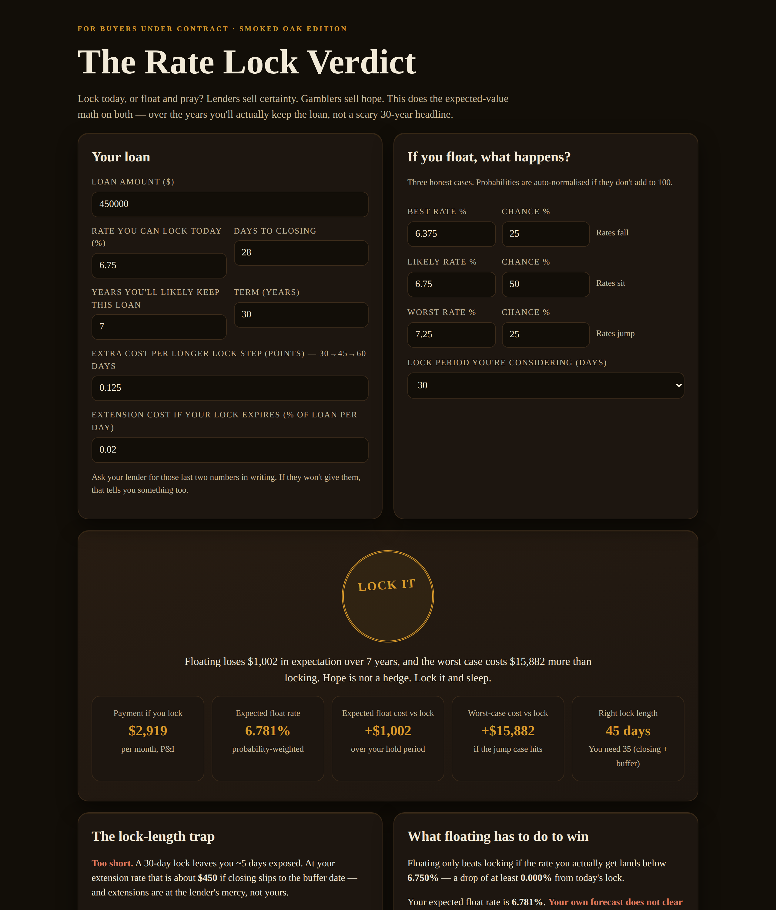

# The Rate Lock Verdict

**Live:** https://thebullbrew.github.io/rate-lock-verdict/

Lock today, or float and pray? This tool does the expected-value math on locking your mortgage rate vs floating to closing — over the years you'll actually keep the loan, not a scary 30-year headline.

## What it does
- Probability-weights your best / likely / worst float cases into one expected float rate and one honest cost difference vs locking today
- LOCK IT / FLOAT / CLOSE CALL verdict, with a risk override when the worst case is too big a tail to chase
- Lock-length optimizer: closing date + 7-day buffer = the lock you actually need, priced against paying for longer locks and against extension fees if you go too short
- The break-even drop floating has to deliver to win, and a −0.50% to +0.50% sensitivity table (payment and hold-period cost)
- Saveable scenarios and a copy-ready summary — everything in your browser, no backend

## The method
Hold-period cost is interest actually paid over your expected hold (real amortization), because nobody keeps a 30-year loan for 30 years. When expected value ties, certainty wins — that's not timidity, that's pricing risk honestly.

## Run it
Open `docs/index.html` in any browser, or visit the live link above. Installable as a PWA and works offline after first load.
